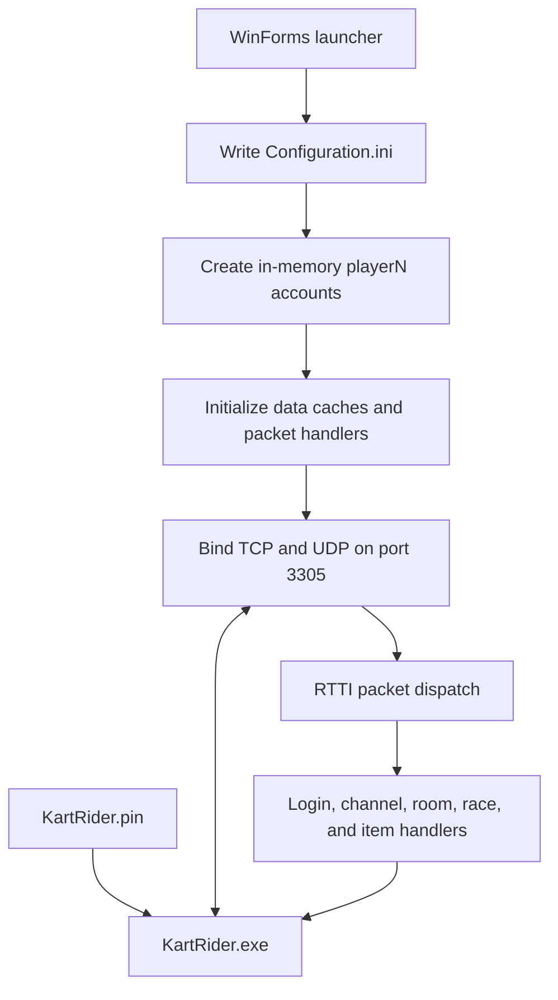

# GLS 2.0

GLS 2.0 is a Windows launcher and community server implementation for a compatible legacy KartRider client. The launcher starts the server, creates local test accounts, can start the game client, and can edit the client's `KartRider.pin` login endpoint.

This is an unofficial community project. It is not affiliated with or endorsed by the owners of KartRider.

## What is included

- A Windows Forms launcher targeting .NET 8 for Windows.
- A TCP and UDP server that handles the client's legacy packet protocol.
- In-memory local accounts named `player1` through `playerN`.
- Channel, garage, room, player, and race state management.
- Game data caches loaded from a compatible `data.bml` file, plus hard-coded kart physics data.
- Item pickup award and item-event relay paths for supported client packet shapes.
- A PIN editor that changes the login server IPv4 address and port.

The server is still a work in progress. The code contains handlers for many client features, but their presence does not mean every feature or game mode has been validated against every client build. See [known limitations](#known-limitations) and the implementation notes in [`docs/PROTOCOL.md`](docs/PROTOCOL.md).

## Requirements

- Windows.
- .NET 8 SDK to build, or the .NET 8 Desktop Runtime to run a framework-dependent build.
- A compatible KartRider client installation and its required data files. The client and game data are not part of this source repository and must be obtained and used separately.

The server reads `data.bml` from the application's base directory. The game client also needs its original runtime files in the expected relative layout. A source-only checkout is not a complete playable distribution.

## Build from source

Run these commands from the directory containing `Launch.csproj`:

```powershell
dotnet restore Launch.csproj
dotnet build Launch.csproj --configuration Release
```

The framework-dependent build output is written to:

```text
bin/Release/net8.0-windows/
```

The project references `MySql.Data` and `Newtonsoft.Json`. The normal launcher startup path uses the built-in in-memory database and does not require a running MySQL server.

## Quick start

1. Build the project, or use a prepared release folder.
2. Place the compatible client files and required data beside the launcher, preserving the directory layout expected by the client. In particular, `data.bml` must be in the launcher application's base directory for the server's game-data caches.
3. Run `GLS 2.0.exe`.
4. Open **Server Settings** and set the server's advertised IPv4 address and the number of local accounts to create. For a single computer, use `127.0.0.1`. For a LAN or VPN session, use an IPv4 address that the other computers can route to.
5. Open **Launcher Options** and select a player number from the configured account range. The account credentials are `playerN` / `playerN` (for example, `player1` / `player1`). Optionally enable automatic client launch and the server console.
6. Click **Server / Game Start**. The launcher writes `Configuration.ini`, initializes the local accounts, starts the server, and waits up to 15 seconds for it to become ready. If automatic launch is enabled, it then starts `KartRider.exe`.
7. If the client is already open or automatic launch is disabled, use **Join Game** to start it manually.
8. To point a client at a different server, use **Set PIN File**, enter the server IPv4 address and port, and save. The editor creates a `.bak` copy before replacing the PIN file.

The server currently uses port **3305** for both TCP and UDP. The main server-start path writes this port into `Configuration.ini`. Although the Server Settings form displays a port field, the current save/start code does not apply that field; the active port remains 3305.

## Launcher controls

| Control | Behavior |
| --- | --- |
| **Server / Game Start** | Writes the runtime configuration, prepares local accounts, starts the server, and optionally launches the client. |
| **Launcher Options** | Selects the local player number, toggles automatic client launch, and opens or closes the server console. |
| **Set PIN File** | Finds a `KartRider.pin` under the launcher directory and edits its first login server endpoint. |
| **Join Game** | Starts `KartRider.exe` with the generated `launcher` profile. |
| **Server Settings** | Sets the advertised IPv4 address and account count for the current launcher session; the expanded panel changes kart physics adjustment values. |

Launcher settings are held in process memory. They are not saved as a persistent user-preferences file. The launcher creates or overwrites `Configuration.ini` each time **Server / Game Start** is pressed.

## Generated runtime files

- `Configuration.ini` — generated server configuration in the launcher directory.
- `Profile/kr/launcher.xml` — generated client profile containing the selected `playerN` credentials.
- `KartRider.pin.bak` — created beside the PIN file when the PIN editor saves changes.
- Console output — server and packet diagnostics are written to the console when it is available. The C# item and unhandled-packet file logs are disabled.

Do not commit generated configuration, profile, PIN, build, or game-client files. They may contain local addresses or credentials, are machine-specific, or may be covered by separate distribution terms.

## Network setup

Both server sockets bind to all local IPv4 interfaces on port 3305. `Server Settings` supplies the address advertised to clients; it does not change the bind address.

- Same computer: advertise `127.0.0.1` and keep the client PIN endpoint at `127.0.0.1:3305`.
- LAN: advertise the server computer's reachable LAN IPv4 address and allow inbound TCP **and** UDP port 3305 through the host firewall.
- VPN: advertise the server's VPN IPv4 address, ensure every client has a route to it, and allow TCP and UDP port 3305 on the VPN/firewall path. The PIN endpoint on each client must use the same address and port.

Do not advertise `0.0.0.0`; it is a bind address, not a usable client destination. The server does not provide TLS or modern account security. Avoid exposing it to the public Internet without independently adding appropriate access controls.

## How it works

At a high level:



For the detailed startup, login, room, race, and reset sequence, see [`docs/ARCHITECTURE.md`](docs/ARCHITECTURE.md). For packet framing, UDP session matching, and item pickup and targeting behavior, see [`docs/PROTOCOL.md`](docs/PROTOCOL.md).

## Project layout

| Path | Responsibility |
| --- | --- |
| `Program.cs`, `Form1.cs`, `Form1.Designer.cs` | Application entry point and main launcher window. |
| `opithon.cs` | Player selection, automatic client launch, and console options. |
| `userset.cs` | Advertised server address, account count, and kart adjustment UI. |
| `Form2.cs` | PIN file discovery, parsing, editing, backup, and encoding. |
| `Common/KartRider.Net` | TCP sessions, server sockets, UDP listener, client registry, and RTTI identifiers. |
| `Common/KartRider.Net.Handler` | Login, player, channel, room, shop, and race packet handlers. |
| `Common/KartRider.Utilities/HandlerStore.cs` | Reflection-based packet-handler discovery and dispatch. |
| `Common/KartRider.IO.Packet` | Binary packet readers/writers and UDP packet helpers. |
| `Common/KartRider.Security` | Legacy packet hash/encryption routines used by the client protocol. |
| `Common/KartRider.Game` | Channels, rooms, garages, inventory objects, and race lifecycle. |
| `Common/KartRider.Game.Players` | Player, session, and item state. |
| `Common/KartRider.Game.Data` | `data.bml` parsers and in-memory game-data caches. |
| `Common/KartRider.Data` | Database access and the built-in local in-memory database. |
| `Common/KartSpac` | Kart data definitions used by the server. |

## Known limitations

- Local accounts and their local database tables are in memory. They are recreated at server startup; local inventory changes are not a durable account database.
- The launcher generates predictable credentials: username and password are both `playerN`. This is intended for a small private test server, not secure account hosting.
- The configured account count and selected player number are not persisted between launcher runs.
- The current launcher always generates a local-mode configuration. Although a MySQL code path exists, the launcher does not expose a complete external-database setup workflow.
- The server supports one configured port, 3305, for TCP and UDP. The port text box in the settings window is currently not connected to the generated configuration.
- Item pickup requests are validated against the supported packet layouts in the source. Targeted item packets are relayed to race peers; this is not a server-authoritative simulation of projectile movement or hit results.
- The server uses a legacy client protocol. Its protocol-specific transforms and checksums are not a replacement for TLS or secure authentication.
- Some features and modes have not been documented as fully tested. Check behavior with the exact client build you intend to use.

## Troubleshooting

| Symptom | Checks |
| --- | --- |
| Server does not become ready | Confirm `data.bml` is beside the executable, port 3305 is free for both protocols, the advertised address is a valid IPv4 address, and the server console shows no startup exception. |
| Client cannot connect | Check the client's `KartRider.pin` endpoint, use an address reachable from that client, and allow inbound TCP and UDP 3305. |
| Client starts with the wrong account | Set the intended player number before launching. The generated profile uses `playerN` for both username and password. |
| Room or race events do not reach peers | Confirm the peers are in the same room and race, the server console shows their TCP and UDP sessions, and both transports can reach port 3305. |
| Item pickup is ignored | Pickup handling requires an active race and a supported client packet shape. Inspect the console's `[Item Pickup]` diagnostics and confirm the client build matches the server's expected protocol. |
| Missile or magnet targeting is not relayed | Targeted item handling only runs for recognized item RTTIs while the sender is in an active race. Check UDP account/session binding and the console's `[Item Relay]` or `[Item Event]` diagnostics. |

The current release path does not create the C# item-diagnostic text files. If reporting an issue, copy only relevant console output and remove addresses, account names, and packet data you do not intend to share.

## Source and redistribution

This checkout contains no `LICENSE` file. Choose and add a license before presenting the source as open source. Do not assume the game's executable, data, PIN, native client DLLs, or other client assets can be redistributed with this project; review their applicable terms and package them separately where required.

See [`docs/DEPLOYMENT.md`](docs/DEPLOYMENT.md) for the release-folder checklist and [`docs/ARCHITECTURE.md`](docs/ARCHITECTURE.md) for the internal operation sequence.
