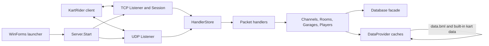

# Architecture and Runtime Flow

This document describes the behavior implemented in the current source tree. It is an implementation map, not a claim that every legacy client feature is complete.

## Component map

### Launcher layer

- `Program.Main` initializes WinForms and opens `Form1`.
- `Form1` writes a fresh `Configuration.ini`, selects local database mode, and starts `Server.Start` on a background task.
- The launcher polls `Server.IsAlive` for up to 15 seconds so socket and data initialization do not block the UI thread.
- If automatic launch is enabled, the launcher writes `Profile/kr/launcher.xml` and starts `KartRider.exe -profile:launcher` with the output directory as its working directory.
- The PIN editor searches recursively below the launcher base directory and edits the first `KartRider.pin` it finds. Saving creates or replaces a `.bak` file beside that PIN.
- `userset` and `opithon` hold their values in static in-process properties. There is no settings persistence layer.

### Server layer

`Common/KartRider.Net/Server.cs` owns the listener lifecycle and shared runtime collections:

- `Channels` contains the configured channel instances.
- `Clients` tracks active TCP clients.
- `Garages` tracks open player garages.
- `UdpClients`, `UdpBackup`, and pending UDP state associate datagrams with TCP player sessions.
- The TCP listener and UDP listener bind to `IPAddress.Any` on the configured server port.

The launcher-generated configuration uses port 3305 and `Database/Host=local`. `ExternalIP` is the endpoint advertised to the client; it is separate from the wildcard socket bind address.

## Server startup sequence

When **Server / Game Start** is clicked:

1. The launcher refuses a second start while `Server.IsAlive` is true.
2. It checks that the selected `playerN` is within the configured account count.
3. It writes `Configuration.ini` under `AppContext.BaseDirectory`, including the advertised address, port 3305, data path, and local database values.
4. It initializes settings and enables the local in-memory database with the requested number of accounts.
5. It selects `playerN` as the login account for the client profile.
6. It starts `Server.Start` on a task and waits up to 15 seconds for the server-ready flag.
7. `Server.Start` resets channels and client/session tables, reads settings, initializes packet handlers, initializes the data provider, and creates the TCP and UDP listeners.
8. After both listeners are bound, `Server.IsAlive` becomes true and the launcher may start the game client.
9. The server accepts TCP sockets. Each accepted socket becomes a `KartClient`/`Session`, which begins asynchronous packet framing and dispatch.

The server configures five channels in source: `novice`, `rookieIntro`, `rookie`, `lv3`, and `lv2`, each with a capacity value of 60.

## Data initialization and persistence

`DataProvider.Initialize` builds caches for karts, levels, tracks, strings, shop stock, and characters. Track, level, string, character, and shop records are read from `data.bml` in the application's base directory. Kart physics records are supplied by `CachedKarts` in code.

The local database implementation is in `Common/KartRider.Data/Database.cs`. In local mode it creates in-memory `accounts`, `players`, and `items` tables and seeds `player1` through `playerN`. It also seeds default inventory using the loaded game data where available. This data is process-local; restarting the server recreates it.

The `Database` facade also contains a MySQL route, but the launcher startup code always writes `Host=local` and enables local mode. The launcher UI does not currently provide MySQL connection configuration.

## Login and player creation

1. The client reads `Profile/kr/launcher.xml` when launched with `-profile:launcher`.
2. It obtains the login endpoint from its own `KartRider.pin` file and connects to the configured server.
3. `PlayerHandler.HandleLogin` parses the account-data profile and reads the username and password.
4. In local mode, the credentials are checked against the selected in-memory local account.
5. `LoginHandler.HandleGetRider` creates a `Player` for the account and loads the player and item data.
6. The response packet returns the rider profile and equipped item slots to the client.
7. Channel and UDP registration requests update the player's channel state and associate the UDP endpoint with the account/session.

With the default local setup, credentials are `player1` / `player1`. If the account count is raised, the same pattern applies to `player2`, `player3`, and so on. These names are account identifiers, not unique human identities.

## Channel, room, and race sequence

### Channel and room

1. A logged-in player joins a channel.
2. The client requests a room list or creates a room through `ChannelHandler`.
3. The server creates a `Room`, assigns its channel-local room ID, initializes the room with the creator as master, and adds it to the channel.
4. Joining a room validates the room ID and optional room password, then assigns a room slot.
5. Room packet handlers update ready state, closed slots, track selection, and master-only actions. `Room.UpdateSlotData` broadcasts the refreshed room and player slots.

### Race start

1. The room master requests a start.
2. `GameRoomHandler.HandleStart` checks that the sender is the master. With multiple players, all active participants must be ready. The handler also requires a valid track ID for the multi-player ready check.
3. `Room.Start` selects a track if needed, resets race state, and sends the race-start command and kart/session data to each player.
4. Each active racer sends a prepared status. Once all active racers are prepared, `Room.Race` marks the room as racing and sends a seven-second client countdown.

The current start handler allows a one-player room to start without applying the multi-player ready and track checks.

### Finish, results, and room reset

1. A player's `Finished` status is accepted once for its active slot. The room records elapsed time and assigns the next rank.
2. When the first racer finishes, the room sends the client middle/retire state with a 10-second delay and starts the server-side finish timer.
3. When the timer expires, `FinishRace` builds a result entry for each non-observer player. Racers who did not finish are represented as retired.
4. The server sends the result packet, then broadcasts the finish control state with a four-second client-stage duration.
5. About 4.5 seconds later, the room resets racers to `NotReady`, clears their prepared/finish/rank/time fields, marks the room as no longer racing, and broadcasts updated slot data.

The result reset returns players to their existing room, not to the channel's room list. The room master or players can then change settings, ready up, or leave as supported by the client flow.

## Packet dispatch

`HandlerStore.Initialize` scans loaded assemblies for methods decorated with `PacketHandlerAttribute` and registers their RTTI values. TCP dispatch reads the RTTI from the start of a packet; UDP dispatch reads it after the account and sequence fields. The registered handler receives an `InPacket` positioned after the dispatch header.

Handlers are grouped by domain:

- `LoginHandler` and `PlayerHandler`: login, rider, player profile, inventory, and channel/player operations.
- `ChannelHandler`: channels, room list/create/join, and UDP registration/time-sync operations.
- `GameRoomHandler` and `RoomHandler`: room state, track, ready/start, garage, and chat events.
- `GameHandler`: race packet relay, pickup award, targeted item relay, and other race events.
- `ShopHandler`: shop queries and item purchases.

Unknown RTTIs are reported to the console and dropped. Handler exceptions are caught and logged rather than being allowed to unwind through the socket callback.

## Console diagnostics

`KartRider.IO.Log` and several handler paths write diagnostics to the console. Item pickup, item relay, and unhandled-packet file logging are disabled in the current C# source. The launcher can allocate a console from **Launcher Options**. Client-side native DLLs, if included in a release folder, may have their own logging behavior outside this C# project.
